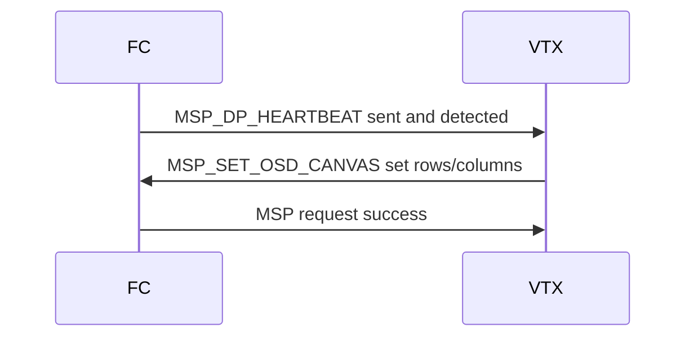
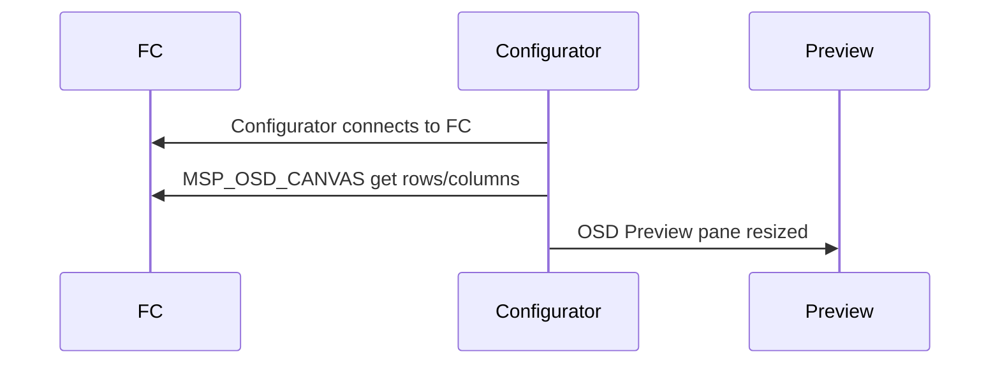

# DisplayPort MSP Extensions

Betaflight supports what is sometimes referred to as Canvas Mode whereby the OSD can send arbitrary character strings to be displayed at given screen coordinates.

## DisplayPort MSP commands

### MSP_SET_OSD_CANVAS

The MSP_SET_OSD_CANVAS command is sent by the VTX, or display device, to the FC to indicate the size of the canvas available to the DisplayPort rendering when in HD mode. HD mode, as is indicated by `vcd_video_system = HD` is automatically set on reception of this command.

| Command            | Msg Id | Direction | Notes                |
| ------------------ | ------ | --------- | -------------------- |
| MSP_SET_OSD_CANVAS | 188    | to FC     | Sets the canvas size |

| Data        | Type  | Notes                 |
| ----------- | ----- | --------------------- |
| canvas_cols | uint8 | The number of columns |
| canvas_rows | uint8 | The number of rows    |



### MSP_OSD_CANVAS

The MSP_OSD_CANVAS command is sent by the configurator to the FC to determine the size of the canvas available to the DisplayPort rendering when in HD mode. This is then used on the OSD tab to show the correct number of rows/columns when editing the OSD element positions.

| Command        | Msg Id | Direction | Notes                |
| -------------- | ------ | --------- | -------------------- |
| MSP_OSD_CANVAS | 189    | to FC     | Gets the canvas size |

Response is two bytes.

| Data        | Type  | Notes                 |
| ----------- | ----- | --------------------- |
| canvas_cols | uint8 | The number of columns |
| canvas_rows | uint8 | The number of rows    |



### MSP_DISPLAYPORT

The MSP_DISPLAYPORT command is sent by the FC to the display device/VTX to perform a DisplayPort operation.

| Command         | Msg Id | Direction | Notes                                |
| --------------- | ------ | --------- | ------------------------------------ |
| MSP_DISPLAYPORT | 182    | from FC   | DisplayPort specific commands follow |

One of the following sub-commands will then follow.

## DisplayPort sub-commands

#### MSP_DP_HEARTBEAT

| Command          | Msg Id | Notes                                                            |
| ---------------- | ------ | ---------------------------------------------------------------- |
| MSP_DP_HEARTBEAT | 0      | Prevent OSD Slave boards from displaying a 'disconnected' status |

#### MSP_DP_RELEASE

| Command        | Msg Id | Notes                                                                                                   |
| -------------- | ------ | ------------------------------------------------------------------------------------------------------- |
| MSP_DP_RELEASE | 1      | Clears the display and allows local rendering on the display device based on telemetry information etc. |

#### MSP_DP_CLEAR_SCREEN

| Command             | Msg Id | Notes             |
| ------------------- | ------ | ----------------- |
| MSP_DP_CLEAR_SCREEN | 2      | Clear the display |

#### MSP_DP_WRITE_STRING

| Command             | Msg Id | Notes          |
| ------------------- | ------ | -------------- |
| MSP_DP_WRITE_STRING | 3      | Write a string |

| Data      | Type      | Notes                                                         |
| --------- | --------- | ------------------------------------------------------------- |
| row       | uint8     | Row on which to position the first character of the string    |
| column    | uint8     | Column on which to position the first character of the string |
| attribute | uint8     | Byte indicating the font to use and if the text should flash  |
| string    | uint8 x n | Up to 30 characters, not NULL terminated; the length is given by the MSP payload size |

The `attribute` parameter is encoded thus.

| Field                      | Bits  | Comment                                                       |
| -------------------------- | ----- | ------------------------------------------------------------- |
| Version                    | 7     | Must be 0                                                     |
| DISPLAYPORT_MSP_ATTR_BLINK | 6     | Set to have the display device automatically blink the string |
| Reserved                   | 2 - 5 | Must be 0                                                     |
| Font number                | 0 - 1 | Selects one of four fonts, each of 256 8 bit characters       |

Betaflight splits longer strings into several MSP_DP_WRITE_STRING commands and does not send spaces that fall on cells left blank by the last MSP_DP_CLEAR_SCREEN, so one OSD element may arrive as more than one write.

#### MSP_DP_DRAW_SCREEN

| Command            | Msg Id | Notes                                                              |
| ------------------ | ------ | ------------------------------------------------------------------ |
| MSP_DP_DRAW_SCREEN | 4      | Triggers the display of a frame after it has been cleared/rendered |

#### MSP_DP_OPTIONS

| Command        | Msg Id | Notes                                                                                                                                                                                                            |
| -------------- | ------ | ---------------------------------------------------------------------------------------------------------------------------------------------------------------------------------------------------------------- |
| MSP_DP_OPTIONS | 5      | Not used by Betaflight. Used by INAV and Ardupilot to set display resolution. 0 = SD (30x16), 1 = HD (50x18), 2 = 30x16 SD grid centered in an HD 50x18 grid (HDZero uses), 3 = 60x22 ( used by INAV / DJI WTF ) |

#### MSP_DP_SYS

| Command    | Msg Id | Notes                                                                  |
| ---------- | ------ | ---------------------------------------------------------------------- |
| MSP_DP_SYS | 6      | Display system element displayportSystemElement_e at given coordinates |

| Data           | Type  | Notes                                                          |
| -------------- | ----- | -------------------------------------------------------------- |
| row            | uint8 | Row on which to position the first character of the string     |
| column         | uint8 | Column on which to position the first character of the string  |
| system_element | uint8 | System element to be rendered by the VTX/goggle/display device |

`system_element` will be one of the following as defined by `displayPortSystemElement_e `. Once one MSP_DP_SYS sub-command has been received by the VTX/goggle/display device then the default system elements should no longer be displayed in their default locations, but only explicitly as directed by this command. In this way, the default behavior is as before, but as soon as any system element is explicitly positioned these OSD elements behave just like any other and can be called up is specific locations by any given OSD profile.

```
// System elements rendered by VTX or Goggles
typedef enum {
    DISPLAYPORT_SYS_GOGGLE_VOLTAGE = 0,
    DISPLAYPORT_SYS_VTX_VOLTAGE = 1,
    DISPLAYPORT_SYS_BITRATE = 2,
    DISPLAYPORT_SYS_DELAY = 3,
    DISPLAYPORT_SYS_DISTANCE = 4,
    DISPLAYPORT_SYS_LQ = 5,
    DISPLAYPORT_SYS_GOGGLE_DVR = 6,
    DISPLAYPORT_SYS_VTX_DVR = 7,
    DISPLAYPORT_SYS_WARNINGS = 8,
    DISPLAYPORT_SYS_VTX_TEMP = 9,
    DISPLAYPORT_SYS_FAN_SPEED = 10,
    DISPLAYPORT_SYS_COUNT,
} displayPortSystemElement_e;
```

## Display device behaviour

Display devices implement the protocol differently. The following was measured on a DJI O3 Air Unit (firmware 2024-07) with DJI Goggles 2 (firmware 2025-02) using a fake flight controller on the Air Unit UART and frame captures from the goggles.

| Behaviour | DJI O3 + Goggles 2 |
| --------- | ------------------ |
| Canvas | 53x20 in HD canvas mode, 30x16 in Normal mode, selected in the goggles menu only. MSP_SET_OSD_CANVAS / MSP_OSD_CANVAS pushed by the FC are ignored and the device never sends MSP_SET_OSD_CANVAS. |
| Screen load | The goggles keep what was written since the last MSP_DP_CLEAR_SCREEN, spaces included. Rewriting a cell does not count again and erasing with spaces does not free it. A MSP_DP_DRAW_SCREEN whose load is over the limit is discarded as a whole and the previous frame stays on screen, which looks like a frozen OSD. Only MSP_DP_CLEAR_SCREEN frees it. The limit is not a plain count of cells: 637 cells fit in solid rows of 53 columns, 620 in rows of 50, 459 in pairs and 361 when they are two columns apart. With the goggles' "Flight Controller" menu set to INAV it is about 15% lower: 537 cells in solid rows of 53, 326 cells two columns apart. |
| String length | Up to 32 characters per MSP_DP_WRITE_STRING are drawn. A string starting inside the canvas but running past the last column continues on the next row. |
| Frame rate | About 30-40 MSP_DP_DRAW_SCREEN per second are rendered; faster updates are queued and latency grows (up to 5 s at 100 Hz). A full screen is limited to about 8 frames per second by the 115200 baud UART. |
| Persistence | Content is kept between draws without a clear. MSP_DP_RELEASE clears the OSD. Without MSP_DP_HEARTBEAT the OSD is hidden after about 5 s but its content is kept. Goggles switched off and on again draw nothing until the next MSP_DP_CLEAR_SCREEN. The Air Unit polls the flight controller the same way whether the goggles are on or off, so the flight controller cannot tell. |
| Attribute | Ignored in Betaflight mode: one font page, no device blink, bit 7 ignored. In INAV mode page 0 holds the INAV font and page 1 other INAV symbols; pages 2 and 3 are empty. |
| Not supported | MSP_DP_OPTIONS, MSP_DP_SYS (all elements), MSP_DP_FONTCHAR_WRITE and sub-commands 7-255 are ignored, as are MSP_DISPLAYPORT frames in MSP v2. The FC variant is not queried. |

HDZero VTX announces its canvas with MSP_SET_OSD_CANVAS when it starts and keeps a fixed grid of cells that its clear fills with spaces. No limit like the one above is known for it; none was measured.

### How Betaflight sends the screen

A busy OSD sent whole every frame, as clear, every element and draw, does not fit through a 115200 baud UART together with the answers to the Air Unit's polls. What does not fit in the serial transmit buffer is dropped without a trace, so elements go missing and draws are lost: on a flight controller with a heavy layout, only about 5 of 12 draws a second reached the goggles, and half the frames were incomplete. With `displayport_msp_send_changes = ON`, the default:

- The OSD waits for room in the serial buffer before it writes, instead of losing what does not fit.
- Betaflight keeps a table of the writes the device holds (place, length, attribute and a hash of the characters, no copy of the screen) and sends only the writes that changed. Writes a frame does not repeat are blanked with spaces. No MSP_DP_DRAW_SCREEN is sent when nothing changed. Spaces are not sent to cells that are blank on the device.
- Once a second the device is cleared and sent the whole screen in one draw. This brings back goggles that were switched off and on, repairs a write the device missed, and frees the DJI screen load. The device shows a frame at the draw, so the clear does not flash.
- The CMS draws without clearing, so while a menu is open Betaflight sends the clear itself and has the CMS draw its page again. The draw waits until the page is back, so the goggles never show half a page. Each new menu page also starts with a clear.

On the same flight controller this took the UART from about 100 % to 43 % at `osd_framerate_hz = 12` and 62 % at 30, with every frame complete. The layout of those tests has 50 elements, among them the artificial horizon and sidebars, the compass bar, both stick overlays, PIDs, GPS, timers, battery and power values and warnings:


With the flight controller turned by hand, the goggles were snapshotted twice a second. Ten seconds of those snapshots, at twice the speed, master on the left and the change on the right; for master they are the ten seconds with the most elements missing, and the two sides are separate runs:


 This applies to the default HD canvas of 53x20 and smaller ones. For a device that does not keep its screen between draws, set `displayport_msp_send_changes = OFF`.

For the DJI screen load, Betaflight keeps a map of the device cells written since the last MSP_DP_CLEAR_SCREEN and works out the load: one per cell, plus 0.75 for a cell two columns from the one before it in screen order and 1.3 for one three or more columns away. This is an empirical fit to the measurements above, as the goggles' internals are unknown. A write that would take the load over `displayport_msp_cell_budget` is held back and the device is cleared at the start of the next frame. A screen too big even right after a clear leaves out what does not fit until the next clear.

The budget applies to the default HD canvas of 53x20 only. DJI never announces a canvas, while a device that does, as HDZero does with 50x18 in MSP_SET_OSD_CANVAS, sets the canvas of the OSD and so switches the budget off. For other devices without such a limit that use the default canvas, set it to 0.

Set `debug_mode = MSP_DISPLAYPORT` to see what the link and the device carry.

| debug | Value |
| ----- | ----- |
| 0 | Bytes sent in the frame |
| 1 | Cells sent in the frame |
| 2 | Screen load since the last clear, in cells |
| 3 | Writes held in the table (up to 96) |

### The goggles' own interface

DJI goggles draw their own widgets over the characters sent by the flight controller, and an element placed under one is partly hidden. They cannot be moved by the flight controller: `MSP_DP_SYS` is ignored. On an HD canvas of 53x20 cells, in Betaflight mode and in INAV mode, a bench with Goggles 2 (firmware 2025-02) and the default goggles interface found them here, cells counted from 0:

| Zone | Rows | Columns | What |
| ---- | ---- | ------- | ---- |
| A | 5-6 | 44-49 | Remaining recording time of the air unit and of the goggles |
| B | 16 | 36-49 | Notifications, with their own background |
| C | 18 | 35-48 | Air unit voltage, link, bitrate, goggles battery |


```
   0         1         2         3         4         5  
   01234567890123456789012345678901234567890123456789012
 0 .....................................................
 1 .....................................................
 2 .....................................................
 3 .....................................................
 4 .....................................................
 5 ............................................AAAAAA...
 6 ............................................AAAAAA...
 7 .....................................................
 8 .....................................................
 9 .....................................................
10 .....................................................
11 .....................................................
12 .....................................................
13 .....................................................
14 .....................................................
15 .....................................................
16 ....................................BBBBBBBBBBBBBB...
17 .....................................................
18 ...................................CCCCCCCCCCCCCC....
19 .....................................................
```

Each widget is given the rows its text lines sit in; their edges reach a few pixels into the next row. Keep elements out of these cells. Everywhere else the goggles draw nothing of their own, up to the edges of the screen. Other goggles settings, other firmware and the Normal canvas mode were not measured, and a goggles interface with more widgets enabled will use more cells.

## Settings

| Setting | Default | Notes |
| ------- | ------- | ----- |
| `displayport_msp_send_changes` | ON | Send only the writes that changed, and the whole screen once a second. OFF sends every frame whole, for a device that does not keep its screen. |
| `displayport_msp_cell_budget` | 620 | Maximum screen load, in cells. 620 suits DJI goggles in Betaflight mode (the limit is 637 or more), 520 in INAV mode. 0 disables the limit. |
| `displayport_msp_fonts` | 0,1,2,3 | Font page for normal, info, warning and critical severity. |
| `displayport_msp_use_device_blink` | OFF | When ON the blink attribute is sent and the device blinks the text. DJI O3/Goggles 2 ignore it, so leave it OFF there. |
| `displayport_msp_col_adjust`, `displayport_msp_row_adjust` | 0 | Reduce the area used by the OSD in SD mode. |
| `osd_framerate_hz` | 12 | With `displayport_msp_send_changes = ON`, DJI goggles can take up to 30. They render at most about 35-40 draws a second, so higher rates only add latency. |

### DJI goggles in INAV mode

Set the goggles' "Flight Controller" menu to Betaflight when flying Betaflight. The menu is global and the flight controller cannot detect it, because the goggles never query the FC variant.

In INAV mode page 0 holds the INAV font, whose symbols do not match Betaflight's. The default `displayport_msp_fonts = 0,1,2,3` draws info text from page 1, which holds other INAV symbols, and warning and critical text from pages 2 and 3, which are empty, so no warning is visible. A pilot who keeps INAV mode should set `displayport_msp_fonts = 0,0,0,0` and `displayport_msp_cell_budget = 520`.
