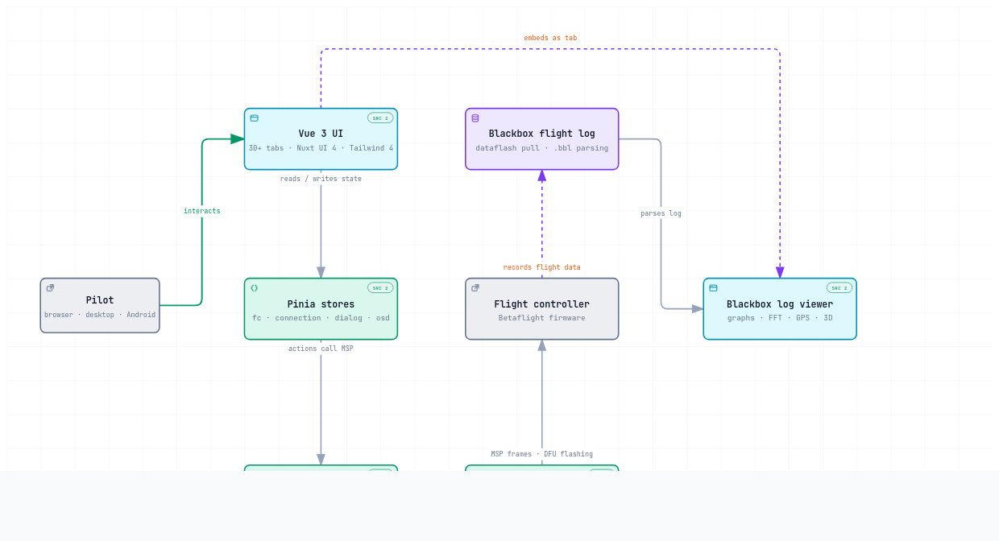

import { useColorMode } from '@docusaurus/theme-common';
import useBaseUrl from '@docusaurus/useBaseUrl';

export function ArchitectureDiagram() {
  const { colorMode } = useColorMode();
  const src = useBaseUrl('/diagrams/configurator-architecture');
  return (
    <>
      <iframe
        key={colorMode}
        src={`${src}?embed=1&theme=${colorMode}`}
        title="Betaflight Configurator architecture diagram"
        loading="lazy"
        style={{ width: '100%', aspectRatio: '1160 / 700', border: 0 }}
      />
      

        <a href={src} target="_blank" rel="noopener noreferrer">
          Open the diagram full screen
        </a>{' '}
        to inspect components and their source references, and to use the theme switch, presentation mode and export options.
      

    </>
  );
}

# Configurator Architecture

This page gives a high-level overview of how [Betaflight Configurator](https://github.com/betaflight/betaflight-configurator) is put together, from the user interface down to the flight controller.
It is aimed at developers who want to find their way around the codebase before making a change.

<ArchitectureDiagram />

## Layers

- **Vue 3 UI** - the tabs in `src/components/tabs/`, registered in `src/js/vue_tab_registry.ts`. Built with the Composition API, Nuxt UI 4 and Tailwind CSS 4.
- **Pinia stores** - application state in `src/stores/`, such as `fc`, `connection`, `dialog` and `osd`. Components read and write state here rather than talking to the flight controller directly.
- **MSP protocol layer** - `src/js/msp/` encodes and decodes [MSP](./MSP-Protocol-Reference-Dev.md) messages (`MSPCodes`, `MSPHelper`, `MSPConnector`). Only stores, composables and code under `src/js` should call the MSP client.
- **Transport backends** - `src/js/protocols/` holds pluggable transports: WebSerial, WebBluetooth, USB DFU (firmware flashing), Tauri (desktop) and Capacitor (Android).
- **Flight controller** - the Betaflight firmware acts as the MSP server.
- **Blackbox** - flight logs are pulled from the flight controller's dataflash and opened in the Blackbox log viewer, which ships as a tab inside the Configurator. Its Canvas graph renderers stay framework-agnostic.

## Platforms

The same codebase is delivered as a PWA in the browser, a desktop app built with Tauri 2, and an Android app built with Capacitor 8.

## Static Version

If the interactive diagram does not load, here is a static image of it:

